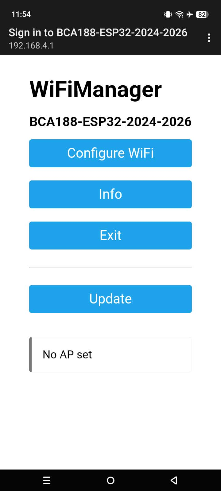
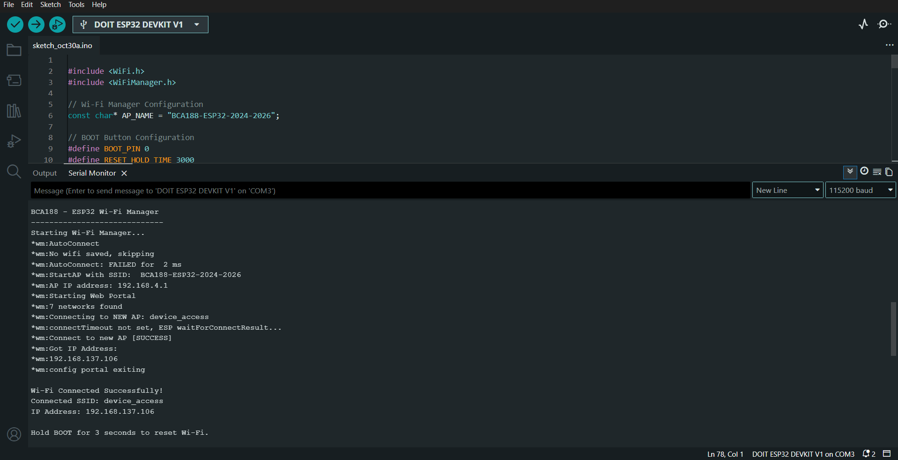

# BCA188 – Laboratory Activity 9
### ESP32 Wi-Fi Manager

**Individual Laboratory Activity**

**Bert Alde J. Arias**  
Student ID: `2024-2026`

**BCA188 – Wireless Connectivity**

---

## Navigation

- [Overview](#overview)
- [Objectives](#objectives)
- [Hardware and Software](#hardware-and-software)
- [Practice Task Results](#practice-task-results)
- [Screenshots and Evidence](#screenshots-and-evidence)
- [Explanation](#explanation)
- [Source Code](#source-code)
- [Conclusion](#conclusion)

---

## Overview

This laboratory activity demonstrates the implementation of **WiFiManager** on an ESP32 DevKit V1 to connect to different Wi-Fi networks without modifying or reuploading the program.

The ESP32 creates a configuration portal where users can select an available Wi-Fi network and enter its credentials through a smartphone.

The program also includes a **180-second configuration timeout** and a **3-second BOOT button reset** to clear saved network credentials.

**Access Point Name:** `BCA188-ESP32-2024-2026`  
**Configuration Portal:** `192.168.4.1`  
**Serial Baud Rate:** `115200`

---

## Objectives

- Configure WiFiManager on an ESP32.
- Connect to Wi-Fi through a configuration portal.
- Observe the behavior when an incorrect password is entered.
- Reset saved Wi-Fi credentials using the BOOT button.
- Modify the ESP32 access point name.
- Connect to a different Wi-Fi network without changing the connection code.

---

## Hardware and Software

| Component | Description |
|:---|:---|
| Microcontroller | DOIT ESP32 DevKit V1 |
| Development Environment | Arduino IDE |
| Library | WiFiManager by tzapu |
| Programming Language | C++ (Arduino) |
| Connectivity | 2.4 GHz Wi-Fi |
| Configuration Device | Smartphone |
| Connection | USB Cable |

---

## Practice Task Results

The following table summarizes the observations recorded during the laboratory testing.

| Task | What to Do | What I Observed |
|:---|:---|:---|
| **1. Wrong Password** | Enter an incorrect password on the setup page. | The ESP32 failed to connect and displayed repeated connection errors. After the configuration portal timed out, the board automatically restarted. |
| **2. Reset Settings** | Hold the BOOT button for 3 seconds. | The ESP32 erased its saved Wi-Fi credentials and automatically restarted, allowing the network to be configured again. |
| **3. Change the Name** | Modify the access point name and upload the code. | The modified SSID, `BCA188-ESP32-2024-2026-BERT`, appeared in the phone's Wi-Fi list and WiFiManager portal. |
| **4. Different Network** | Reset the board and connect to another Wi-Fi network. | The ESP32 successfully connected to `Secure me_2.4` instead of `device_access`, receiving a new IP address without changing the connection code. |

---

## Screenshots and Evidence

### 1. WiFiManager Setup Page

The ESP32 successfully created its access point, and the WiFiManager configuration portal was accessible through `192.168.4.1`.

  

  <em>Figure 1. WiFiManager configuration portal accessed using a smartphone.</em>

### 2. Successful Wi-Fi Connection

The Serial Monitor confirmed that the ESP32 successfully connected to the `device_access` network and received the IP address `192.168.137.106`.

  

  <em>Figure 2. Serial Monitor showing a successful Wi-Fi connection and assigned IP address.</em>

### 3. Additional Testing Evidence

The following screenshots document the results of the practice tasks.

| Test | Evidence |
|:---|:---|
| Wrong Password | [View Screenshot](screenshots/wrong-password.png) |
| Configuration Timeout and Restart | [View Screenshot](screenshots/timeout-restart.png) |
| BOOT Button Reset | [View Screenshot](screenshots/reset-settings.png) |
| Modified Access Point Name | [View Screenshot](screenshots/changed-ap-name.jpg) |
| Different Wi-Fi Network | [View Screenshot](screenshots/different-network.png) |

---

## Explanation

The ESP32 connected to a different Wi-Fi network without changing the code because **WiFiManager allows new Wi-Fi credentials to be entered through its configuration portal and saves them in the ESP32's non-volatile memory for future connections.**

---

## Source Code

The complete Arduino sketch, including the WiFiManager configuration, 180-second timeout, and BOOT button reset functionality, is available below.

**[View WiFi_Manager.ino](WiFi_Manager/WiFi_Manager.ino)**

---

## Conclusion

In this laboratory activity, I successfully configured WiFiManager on the ESP32 and tested its ability to connect to different Wi-Fi networks.

The tests demonstrated that incorrect passwords caused connection failures, saved credentials could be cleared using the BOOT button, and the access point name could be modified.

Most importantly, the ESP32 successfully connected to another Wi-Fi network without requiring changes to the connection code, demonstrating the usefulness of WiFiManager for flexible network configuration.

---

**BCA188 – Laboratory Activity 9**

ESP32 Wi-Fi Manager | Individual Activity

